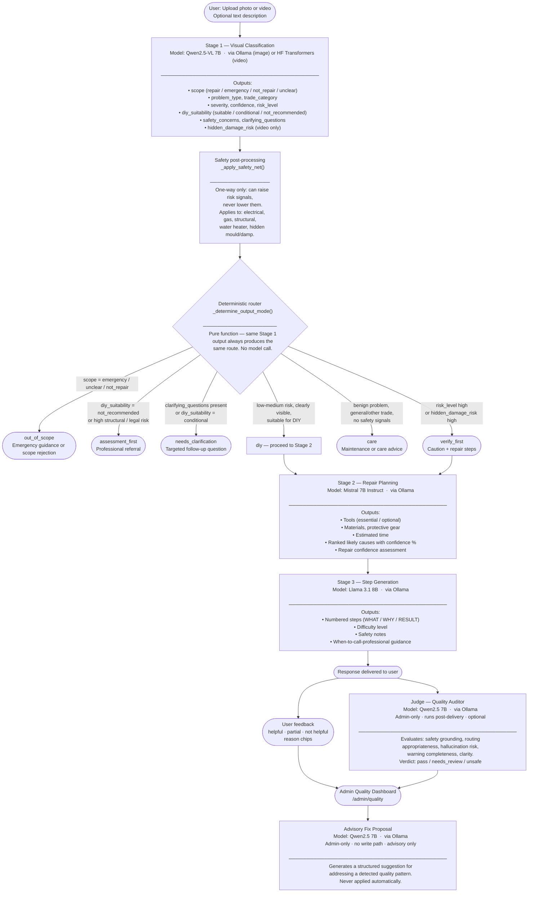

# Knitra — Technical Overview

A concise reference document covering the technology stack, AI models, system architecture, and pipeline flow for the Knitra home repair assistant.

---

## 1. Technology Stack

| Layer | Technology | Version | Role |
|---|---|---|---|
| **Frontend** | NiceGUI | 2.7.0 | Python-rendered single-page UI; syncs state over WebSocket |
| **Backend API** | FastAPI | 0.115.5 | Async REST API (ASGI); handles auth, uploads, analysis, chat, feedback, admin |
| **ASGI server** | Uvicorn | 0.32.1 | Runs the FastAPI app locally |
| **Database** | PostgreSQL | 15 (Docker) | Persistent store for users, sessions, uploads, analyses, messages, feedback |
| **ORM** | SQLAlchemy 2 (async) | 2.0.36 | Async session management; all queries use `await` |
| **Migrations** | Alembic | 1.14.0 | Schema version control; 6 migrations in the current chain |
| **Auth** | passlib + bcrypt | 1.7.4 / 3.2.2 | Password hashing; session tokens are opaque hex strings stored in DB |
| **AI provider** | Ollama (local) | ≥0.4.5 | Serves all text and image models locally; no cloud API required |
| **Image model** | Qwen2.5-VL 7B | via Ollama | Multimodal; used for Stage 1 image classification |
| **Video model** | Qwen2.5-VL-7B-Instruct | HuggingFace Transformers | Same architecture, served locally via `transformers`; used for Stage 1 video frames |
| **Stage 2 model** | Mistral 7B Instruct | via Ollama | Text; generates tools, materials, PPE, root causes |
| **Stage 3 model** | Llama 3.1 8B | via Ollama | Text; generates step-by-step repair instructions and handles chat |
| **Judge model** | Qwen2.5 7B (text) | via Ollama | Admin-only pipeline quality auditor; also backs advisory fix proposals |
| **Audio transcription** | faster-whisper | ≥1.0.0 | Local Whisper inference for voice-to-text; CPU, no GPU required |
| **Video processing** | PyAV (FFmpeg bindings) | ≥12.0.0 | Frame extraction and video metadata for the video analysis path |
| **Image processing** | Pillow | 10.4.0 | Image dimension extraction at upload time |
| **HTTP client** | httpx | 0.27.2 | Used by the NiceGUI frontend to call the backend API |

---

## 2. AI Models

| Model | Size | Provider | Usage |
|---|---|---|---|
| `qwen2.5vl:7b` | ~5 GB | Ollama | Stage 1 — visual classification of uploaded images |
| `Qwen/Qwen2.5-VL-7B-Instruct` | ~15 GB | HuggingFace | Stage 1 — video frame analysis (optional; requires GPU) |
| `mistral:7b-instruct` | ~4 GB | Ollama | Stage 2 — tools, materials, protective gear, root causes |
| `llama3.1:8b` | ~5 GB | Ollama | Stage 3 — repair steps; also the contextual chat assistant |
| `qwen2.5:7b` | ~5 GB | Ollama | Judge / advisory proposals (admin-only; optional) |
| faster-whisper base | ~150 MB | local | Audio transcription for voice input |

> All models run entirely on the local machine. No data is sent to any external service.

### Minimum Ollama models to pull (image analysis only)

```bash
ollama pull qwen2.5vl:7b
ollama pull mistral:7b-instruct
ollama pull llama3.1:8b
```

### Additional model for admin Quality Dashboard

```bash
ollama pull qwen2.5:7b
```

---

## 3. System Architecture

```
┌─────────────────────────────────────────────────────┐
│             Browser / NiceGUI Frontend               │
│         http://localhost:3000                        │
│         frontend/main.py                            │
│                                                     │
│  • Case upload and analysis view                    │
│  • Contextual chat assistant                        │
│  • User feedback (Helpful / Partial / Not helpful)  │
│  • Admin Quality Dashboard (/admin/quality)         │
└───────────────────────┬─────────────────────────────┘
                        │  HTTP REST  (httpx)
┌───────────────────────▼─────────────────────────────┐
│            FastAPI Backend                           │
│         http://localhost:8000                        │
│         backend/main.py                             │
│                                                     │
│  /api/v1/auth          — register, login, logout    │
│  /api/v1/cases         — case CRUD, uploads         │
│  /api/v1/analyses      — trigger & fetch analysis   │
│  /api/v1/chat          — contextual chat messages   │
│  /api/v1/transcribe    — audio → text (Whisper)     │
│  /api/v1/feedback      — user feedback submission   │
│  /api/v1/admin/judge   — admin: trigger judge eval  │
│  /api/v1/admin/quality — admin: quality dashboard   │
└──────────┬───────────────────────┬──────────────────┘
           │                       │
  ┌────────▼────────┐    ┌─────────▼──────────────────┐
  │   PostgreSQL     │    │   Ollama  (localhost:11434) │
  │   port 5433      │    │                            │
  │                 │    │   qwen2.5vl:7b    Stage 1   │
  │  users          │    │   mistral:7b      Stage 2   │
  │  sessions       │    │   llama3.1:8b     Stage 3   │
  │  uploads        │    │   qwen2.5:7b      Judge     │
  │  analyses       │    └────────────────────────────┘
  │  messages       │
  │  feedback       │    ┌────────────────────────────┐
  └─────────────────┘    │  HuggingFace Transformers   │
                         │  (local, GPU required)      │
                         │  Qwen2.5-VL-7B-Instruct     │
                         │  Stage 1 — video frames     │
                         │  (only if VIDEO_ANALYSIS_   │
                         │   ENABLED=true)             │
                         └────────────────────────────┘
```

---

## 4. AI Pipeline Flow

The pipeline runs as a background task after upload. Each stage is independently retried if the model returns malformed JSON.



---

## 5. Output Modes

The router produces one of six output modes. Once set, the mode is never changed by downstream stages.

| Mode | Trigger condition | User sees |
|---|---|---|
| `diy` | Low–medium risk, clearly visible problem, suitable for DIY | Full repair plan: tools, steps, safety notes |
| `verify_first` | High risk OR high hidden-damage risk, but DIY not ruled out | Caution notice + repair plan |
| `assessment_first` | DIY explicitly not recommended, or high structural/legal risk | Professional referral with explanation |
| `needs_clarification` | Critical information missing (conditional suitability or explicit clarifying questions) | Targeted question to the user |
| `care` | Benign problem with no repair needed | Maintenance or care advice |
| `out_of_scope` | Emergency detected, or problem is not a home repair | Emergency guidance or scope rejection |

---

## 6. Key Design Decisions

| Decision | Rationale |
|---|---|
| **All inference local (Ollama / HF Transformers)** | No user photos, audio, or repair data leave the machine. Meets privacy requirements for a home context. |
| **Deterministic routing** | `_determine_output_mode()` is a pure function with no model calls. The same Stage 1 output always produces the same route. Enables reliable unit testing. |
| **One-way safety escalation** | Post-processing rules can only raise risk signals, never lower them. A model that under-estimates risk is corrected; a model that over-estimates is not overridden. |
| **Judge runs post-delivery** | The judge evaluates quality but never blocks or modifies the user response. Decouples QA from the live pipeline. |
| **Advisory proposals only** | Fix proposals are Ollama-generated suggestions surfaced in the admin dashboard. They have no write path and are never applied automatically. |
| **Database tokens, not JWT** | Session tokens are opaque `secrets.token_hex(32)` strings stored in the `user_tokens` table. Simpler to revoke than JWT; no secret key management for tokens. |
| **Pydantic V2 as output contract** | Each stage returns a validated Pydantic model. If the model returns malformed JSON, the stage retries up to `PIPELINE_RETRY_COUNT` times before failing the case. |

---

## 7. Repository Layout

```
FixIT/
├── backend/
│   ├── main.py                        # FastAPI ASGI entry point
│   ├── requirements.txt               # Core backend dependencies
│   ├── requirements-video.txt         # Optional: video + audio dependencies
│   ├── .env.example                   # All environment variable reference
│   ├── alembic.ini
│   ├── alembic/versions/              # 6 schema migrations
│   ├── app/
│   │   ├── api/                       # Route handlers (auth, cases, quality, …)
│   │   ├── core/deps.py               # Auth dependency (require_admin, get_current_user)
│   │   ├── models/                    # SQLAlchemy ORM models
│   │   ├── schemas/                   # Pydantic input/output contracts
│   │   └── services/
│   │       ├── analysis_service.py    # 3-stage pipeline, routing, safety
│   │       ├── video_analysis_service.py  # HF Transformers video path
│   │       ├── judge_service.py       # Pipeline quality auditor
│   │       ├── proposal_service.py    # Advisory fix proposals
│   │       ├── feedback_service.py    # User feedback
│   │       └── quality_service.py    # Dashboard data aggregation
│   └── tests/
│       ├── test_output_mode_routing.py
│       ├── test_scope_routing.py
│       ├── test_auto_clarification_step3.py
│       ├── test_clarification_reasoning.py
│       └── test_manual_reanalysis_context.py
├── frontend/
│   ├── main.py                        # NiceGUI single-file frontend (~7800 lines)
│   └── requirements.txt
├── docker-compose.yml                 # PostgreSQL for local development
├── README.md                          # Full setup and handover guide
├── TECHNICAL_OVERVIEW.md             # This document
├── knitra.ps1                         # Windows: start both servers
├── start_knitra.ps1                   # Windows: start script variant
└── stop_knitra.ps1                    # Windows: stop script
```
